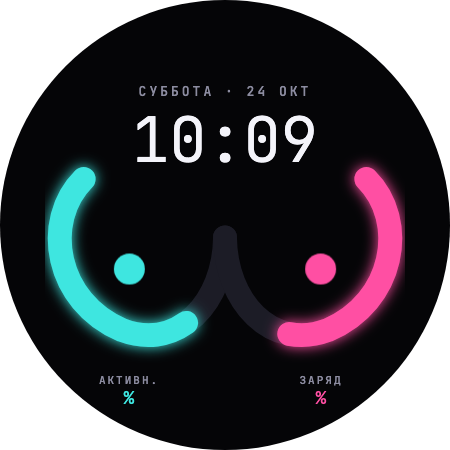

# Fun Bra · Neon Rings

A playful Garmin **watch face** for AMOLED smartwatches. A big, thin digital clock
with the weekday and date sits on top; below it, two mirrored **glowing neon
curves** meet in the middle, each with a blinking dot inside. The curves are not
just decoration: each one **fills up** with a metric of your choice (steps, active
minutes, battery), with a caption and percent underneath. Or switch them to a
purely decorative mode.

Bilingual **English / Русский**. Design: Claude Design artboard
**“01 · Неон-кольца”** (Neon Rings).



*(Design mockup. Its percent placeholders don't render in the export, so it
shows a bare `%`; the face shows e.g. `72%`.)*

---

## The idea

Two curves, two metrics. Each curve lights up from its outer top end toward the
center as the value grows:

| Metric | Fills toward | Caption EN / RU |
|---|---|---|
| Steps | today's step goal | STEPS / ШАГИ |
| Active minutes | today's share of the weekly intensity-minutes goal (goal ÷ 7) | ACTIVE / АКТИВН. |
| Battery | 100 % charge | BATTERY / ЗАРЯД |

Defaults follow the design: **left = active minutes** (turquoise), **right =
battery** (pink). Each curve's metric is chosen separately in the settings.

## Features

- **Neon curves.** Two glowing progress curves on a pure black field. Each is drawn
  as one smooth anti-aliased outline, cached in a bitmap and redrawn only when a
  value changes.
- **Big digital clock** in JetBrains Mono Light, with the full weekday and date
  (`SUNDAY · 25 OCT` / `ВОСКРЕСЕНЬЕ · 25 ОКТ`). Follows the 12/24-hour setting.
- **Blinking dots.** For ~10 s after each wake, the dots blink (1 s bright / 1 s at
  25 %). This can be turned off, and it never runs in always-on mode.
- **Decorative mode.** Both curves are always full, with no captions or numbers.
- **4 color pairs:** turquoise / pink (design), lime / violet, orange / blue,
  scarlet / gold.
- **Bilingual EN/RU.** The face follows the watch's language, or a Language
  setting can force English or Russian. Cyrillic comes from embedded bitmap fonts.
- **AMOLED-first always-on (AOD).** A separate low-power render: thin gray
  clock, date and curve hairlines; no glow, dots or color. ≤ 10 % lit pixels, and
  the layout pixel-shifts every minute.
- **Scales** across round 360 / 390 / 416 / 454 displays and the 448×486
  rectangle (`venux1`). All geometry is the design's 450 px canvas scaled to the
  screen.

## Settings

Available in the Garmin Connect phone app and right on the watch (watch-face
picker → the face's settings):

| Setting | Options |
|---|---|
| Curves | Indicators · Decorative |
| Left curve | Steps to goal · Active minutes today · Battery |
| Right curve | Steps to goal · Active minutes today · Battery |
| Colors | Turquoise / pink · Lime / violet · Orange / blue · Scarlet / gold |
| Language | Auto · English · Russian |
| Blinking dots | On · Off |

## Requirements

Already provisioned on this machine. See [`CLAUDE.md`](CLAUDE.md) for exact paths.

- Connect IQ **SDK 9.1.0**
- **Java 11** (the CIQ command-line tools require it)
- A developer signing key (`developer_key`, git-ignored)

## Build & run

```bash
# Put the SDK bin on PATH and select Java 11
export CIQ_BIN="$HOME/Library/Application Support/Garmin/ConnectIQ/Sdks/connectiq-sdk-mac-9.1.0-2026-03-09-6a872a80b/bin"
export PATH="$CIQ_BIN:$PATH"
export JAVA_HOME="$(/usr/libexec/java_home -v 11)"

# Compile for one device (strict typecheck, warnings on)
monkeyc -f monkey.jungle -o bin/wf_funbra.prg -y developer_key -d venu3 -l 3 -w

# Launch the simulator once (wait for its window), then side-load the build
connectiq
monkeydo bin/wf_funbra.prg venu3

# Build the store package (.iq) for every listed product
monkeyc -f monkey.jungle -o bin/wf_funbra.iq -y developer_key -e -r -w
```

`monkeydo` only connects to a simulator that is already running. “Unable to
connect to simulator” means it isn't, so start `connectiq` first.

In the simulator, check these paths:
- **Settings → Always On**: the AOD render.
- **Settings → System → Language → Russian**: Cyrillic.
- **File → Edit Persistent Storage → Application.Properties**: the settings
  above (decorative mode, metrics, colors, blink).

> Day-to-day, the VS Code **Monkey C** extension (F5 to run/debug) is the smoothest
> workflow. The CLI above is the source of truth for headless/CI builds.

## Install on a real watch (USB cable)

`monkeydo` only loads into the simulator. To run the face on a **physical watch**,
build a `.prg` for that watch's model and copy it onto the device over the cable.
No SDK command pushes to a watch.

1. **Build for your exact model.** Use the device id from the product list in
   [`manifest.xml`](manifest.xml) (e.g. `venu3`, `fr965`, `fenix847mm`,
   `vivoactive5`). The store `.iq` is *not* used here; a watch runs a per-device
   `.prg`:

   ```bash
   monkeyc -f monkey.jungle -o bin/wf_funbra.prg -y developer_key -d venu3 -l 3 -w
   ```

2. **Connect the watch** to the Mac with its charging/data cable.
   - Older watches mount as a normal USB drive in Finder.
   - Newer AMOLED watches (Venu 3, fēnix 8, FR 965, …) use **MTP**, which macOS
     can't mount natively. Install
     **[Android File Transfer](https://www.android.com/filetransfer/)** (free) to
     browse the watch's storage. (On Windows the watch just appears in Explorer.)

3. **Copy `bin/wf_funbra.prg`** into the Connect IQ apps folder on the watch:

   ```
   <watch storage>/GARMIN/Apps/wf_funbra.prg
   ```

   The full path is usually `Internal Storage/GARMIN/Apps/`. You may rename the
   file (e.g. `FunBra.prg`), but keep the `.prg` extension.

4. **Eject** the watch (Finder / Android File Transfer), then unplug it. The watch
   indexes the new app on disconnect.

5. On the watch, open the **watch-face picker** (long-press the current face, or
   *Settings → Appearance → Watch Face*, Connect IQ section) and select
   **Fun Bra**.

Notes:
- The `.prg` is signed with your `developer_key`, so it runs as a normal
  side-loaded app. No special "developer mode" is needed.
- A `.prg` is **model-specific**: one built for `venu3` won't run on another
  device. Rebuild with the matching `-d <id>` for each watch.
- On a hand-copied build, the **on-watch settings menu** works. The Garmin Connect
  phone-app settings are available only for store installs.

## Project structure

```
manifest.xml                 watchface app: 40 AMOLED products, languages (eng+rus), minApiLevel 5.1.0
monkey.jungle                build config (project.typecheck = strict)
source/
  FunBraApp.mc               AppBase: entry point, getInitialView, getSettingsView
  FunBraView.mc              WatchFace: lifecycle, settings, data, blink timer, awake/AOD branch
  FunBraDelegate.mc          WatchFaceDelegate: power-budget fallback hook
  Layout.mc                  design px → screen, curve polylines + normals, bitmap bbox
  Theme.mc                   color tokens, color pairs, pre-blend helper
  model/
    FaceData.mc              per-frame data carrier (model ↔ render decoupling)
    Metrics.mc               steps / active minutes / battery → percent
  render/
    Curve.mc                 curve stroke as one outline polygon + round caps; glow
    CurveLayer.mc            BufferedBitmap cache of both curves
    FaceRenderer.mc          high-power render
    AodRenderer.mc           always-on, burn-in-safe render
  settings/
    SettingsMenu.mc          on-watch settings (Menu2)
resources/                   default locale = English (+ fonts @454, settings, launcher icon)
resources-rus/               Russian bundle
resources-round-<WxH>/       per-resolution font buckets (360/390/416; 454 = base)
tools/fonts/                 bitmap-font generator (JetBrains Mono → NeonTime/Date/Cap/Val)
design/neon-rings/           the original design export + reference.png
GARMIN_STORE.md              store listing (EN/RU) + changelog
```

## Custom fonts

All text uses **JetBrains Mono** (SIL OFL), the font named by the design. It
carries full Cyrillic, so no substitute is needed. There are four Connect IQ
bitmap fonts, one size per resolution tier:
- `NeonTime`: Light, clock digits only.
- `NeonDate`: Medium, letter-spaced; weekday + date.
- `NeonCap`: Medium, letter-spaced; curve captions.
- `NeonVal`: Medium; percent values.

They're subset to the uppercase Latin + Cyrillic alphabets, digits and the few
symbols the face draws. If a font resource is ever missing, the face falls back
to a built-in font. To regenerate, see [`tools/fonts/README.md`](tools/fonts/README.md).

## AMOLED notes

Every target device requires burn-in protection. The face has a separate
always-on render (`AodRenderer`) per Garmin's guidelines: sparse output, gray
palette, no glow or color fills, and a minute-derived pixel shift on everything
that's lit. Animation (the dot blink) runs only in the high-power wake window and
stops itself. The background is pure black so AMOLED pixels stay off. Details
are in [`CLAUDE.md`](CLAUDE.md) and the `neon-rings-face` skill.

## Status & roadmap

- ✅ **1.0.0**: neon curves with glow, metrics per curve, decorative mode, 4 color
  pairs, blinking dots, full AOD path, EN/RU + language setting, on-watch and phone
  settings. Builds clean (`-l 3 -w`) for every resolution tier and packages to
  `.iq` for all listed devices.
- ⏳ **Next**: store screenshots captured from the simulator (`images/`), and
  on-device testing.

## Documentation

- [`CLAUDE.md`](CLAUDE.md): toolchain, build commands, AMOLED rules, conventions
- [`GARMIN_STORE.md`](GARMIN_STORE.md): store listing text + changelog
- `neon-rings-face` skill (`.claude/skills/neon-rings-face/`): the visual source of truth
- `garmin-store-listing` skill (`.claude/skills/garmin-store-listing/`): store card + images

## License

Project code: see repository owner. The bundled font **JetBrains Mono** is under
the [SIL Open Font License 1.1](tools/fonts/src/JetBrainsMono-OFL.txt).
